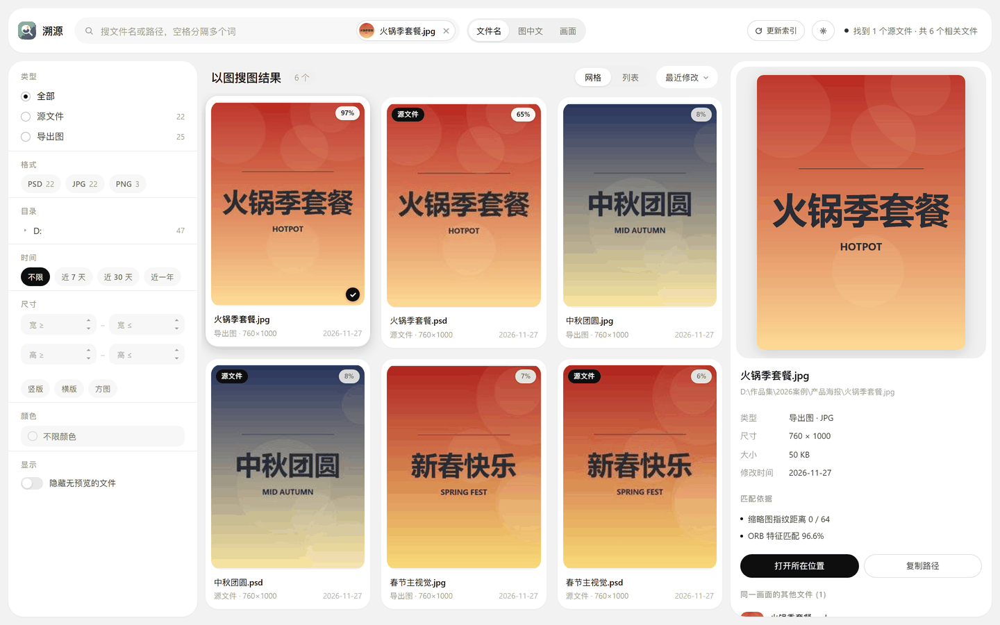
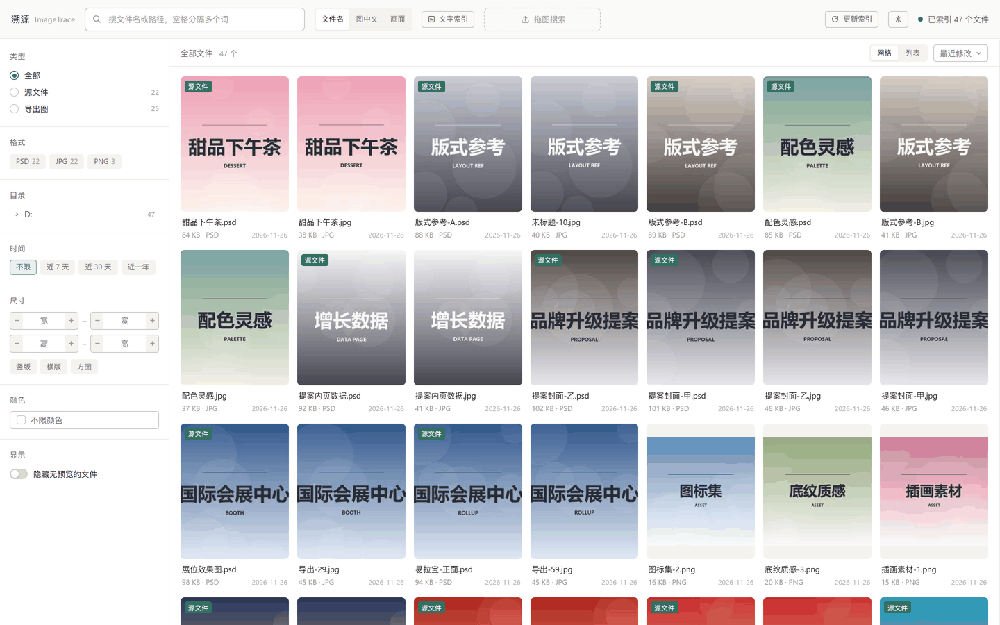
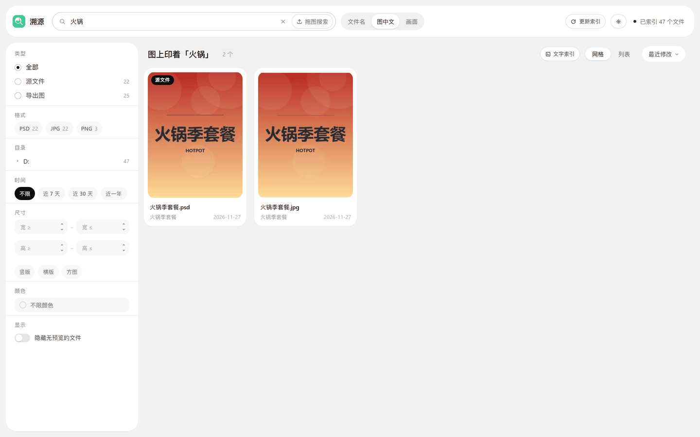
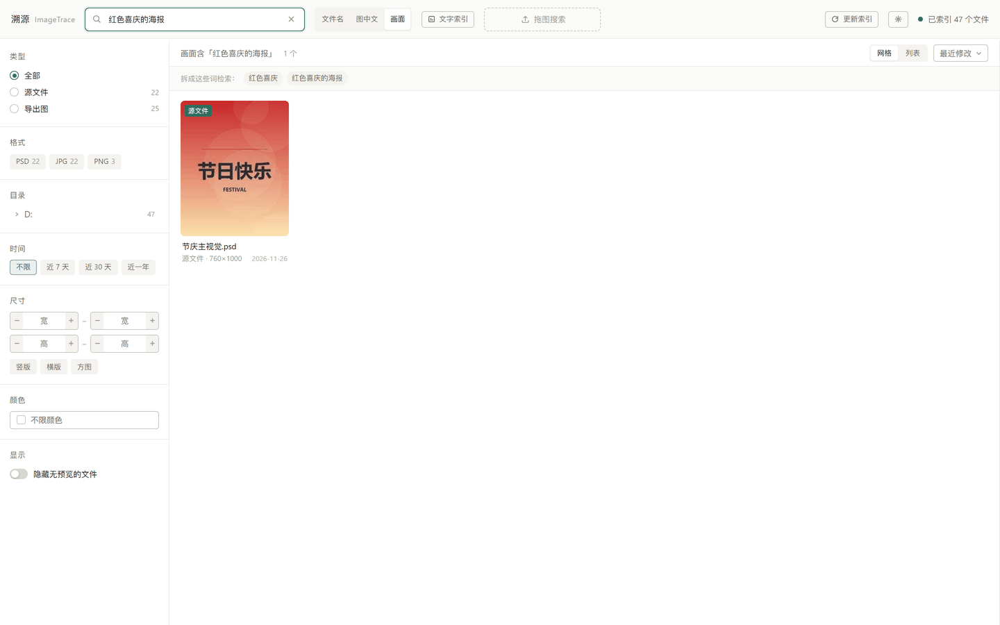

# 溯源 / ImageTrace

Drag an exported image in, find the PSD / AI / CDR source file it came from.
Runs fully offline. No uploads, no telemetry, no account.

<p align="center">
  
</p>

> 中文详细文档在下方，英文只是摘要，方便非中文用户判断这个工具是否合用。
> The English section is a summary. Full documentation below is in Chinese.

---

## Quick start (English)

**The problem.** A colleague sends you a flattened JPG and asks for a change.
You need the PSD behind it. The two files live in different folders, with
different names (`final.psd` exported as `IMG_20240418.jpg`). Duplicate-image
finders can't help — they match *images*, not *an image and its source*.

**What this does.** It reads inside files: PSD image resource blocks, CDR zip
thumbnails, AI/PDF page renders, SVG via resvg, Office shell thumbnails.
So the hits are the **source files themselves**, ranked by visual similarity
(pHash recall → ORB rerank → rotation correction).

**Requirements**

| | |
|---|---|
| OS | Windows 10 1803+ / 11, 64-bit |
| WebView2 Runtime | Ships with Win11. Win10 may need the [free installer](https://developer.microsoft.com/microsoft-edge/webview2/) |
| Disk | ~541 MB program + index (≈520 MB for 18k files) |

No Python needed for the prebuilt release.

**Install**

1. Download `imagetrace-x.y.z-win64.zip` from [Releases](../../releases)
2. Unzip anywhere writable (**not** `C://Program Files`)
3. Run `溯源.exe`
4. Gear icon → add folders to index → wait (~20 min for 18k files)

Queries take 100–300 ms afterwards.

**Four search modes**

| Mode | Input | Use when |
|---|---|---|
| Filename | type in the top bar | you remember the name |
| Reverse image | drag & drop or `Ctrl+V` | you only have the image |
| Text in image | switch to 「图中文」, type | you remember printed text |
| Scene content | switch to 「画面」, type | you remember what it looks like |

The last two need their own indexes, built separately and resumable.

**Limitations.** Phone screenshots with UI chrome: ~10% hit rate. CLIP scene
search has no "no match" signal — it will return something even for objects
not in your library. OCR misses handwriting and heavily stylised display type.

**License.** MIT. Third-party components are MIT / Apache-2.0 / BSD only —
no GPL/AGPL. See [docs/THIRD_PARTY.md](docs/THIRD_PARTY.md).

---

## 中文文档

把同事发来的图拖进窗口，找出它的 PSD / AI / CDR 源文件在哪。

纯本地运行，不上传任何文件，不需要联网。

---

## 它解决什么问题

同事给你一张导出的 JPG 或截图，让你改。你得找到产生这张图的源文件。

难点不在改，在找：源文件和导出图是两个独立文件，可能相隔几个盘，
文件名还往往不一致（`终稿.psd` 导出成 `微信图片_20240418.jpg`）。

**这个工具读文件内部** —— 从 PSD 的 image resource 抽内嵌缩略图，
从 CDR 的 zip 包里抽 `thumbnail.bmp`，从 AI 里渲染首页。所以搜出来的
结果**直接就是源文件本身**，不是它的导出图。

现有工具解决不了这个问题：Eagle / Billfish 要求把文件导入自己的库
（等于复制一份，磁盘翻倍，现有目录结构作废），而且它们不索引 PSD 内部。
图片去重工具找的是「重复的图片」，不是「图和它的源文件」。

---

## 下载使用

### 系统要求

| 项 | 要求 |
|---|---|
| 系统 | Windows 10 1803+ / Windows 11（64 位） |
| **WebView2 运行时** | 界面依赖它。**Win11 自带**；Win10 多数自带，没有的话[微软官网免费下载](https://developer.microsoft.com/microsoft-edge/webview2/) |
| 磁盘 | 程序 541MB + 索引（视文件量，18,000 个文件约 520MB） |
| 内存 | 建议 8GB+（索引时峰值约 2GB） |

不需要装 Python。

### 两个版本

| 版本 | 大小 | 画面搜索 | 适合 |
|---|---|---|---|
| `imagetrace-x.y.z-win64.zip` | 283MB | 有 | 一般使用，开箱即用 |
| `imagetrace-x.y.z-lite.zip` | 141MB | 无 | 只需要「以图搜图」和「图上文字搜索」 |

「画面搜索」= 用自然语言描述画面内容搜图（输入「海边日落」出海滩照）。
它需要 182MB 的中文 CLIP 模型，lite 版把这块去掉了。其余功能完全一致。

### 首次运行

1. 解压到**任意可写目录**（不要放 `C:\Program Files`，索引写在程序旁边）
2. 双击 `溯源.exe`
3. 点右上角齿轮 → 添加要索引的目录（比如 `D:\workspace`）
4. 等索引建完（18,000 个文件约 20 分钟）

索引建好之后，日常查询是 100~300 毫秒。

---

## 四种搜索

| 方式 | 操作 | 解决什么问题 | 前提 |
|---|---|---|---|
| **文件名** | 顶栏输入框打字 | 记得名字或项目名 | 无 |
| **以图搜图** | 拖图到窗口任意位置，或 `Ctrl+V` | 只有一张图，不知道叫什么 | 索引已建 |
| **图上文字** | 切到「图中文」模式输入 | 记得图上印的字（「开业庆典」） | 需先跑一次 OCR |
| **画面内容** | 切到「画面」模式输入 | 只记得画面（「海边日落」） | 需先建语义索引 |

图上文字和画面搜索是两条独立通道，各自的索引单独建、单独补。
顶栏的「文字索引」按钮随时能看到进度、加范围、暂停。

## 界面

<p align="center">
  
</p>

三栏：左侧筛选，中间结果，右侧详情。所有控件自绘，不含任何原生控件。

### 以图搜图

把图拖进来，直接给出源文件：

<p align="center">
  
</p>

查询是左下那张导出图，右侧详情显示「缩略图指纹距离 0/64、ORB 特征匹配 96.6%」，
并列出「同一画面的其他文件」—— 直接就是它的 PSD。

四路信号叠加：内嵌缩略图 → pHash 一级召回 → ORB 二级重排 → 旋转校正。

为什么必须两阶段 —— 实测单一 pHash 的失效场景：

| 查询形态 | 纯 pHash@10 | 两阶段@10 |
|---|---|---|
| 完整导出图 | 10/10 | 10/10 |
| 裁掉 5% | 7/10 | 10/10 |
| 旋转 90° | 0/10 | 9/10 |
| 手机截图带边框 | 1/10 | 3/10 |
| 重新压缩 | 9/10 | 10/10 |

### 图上文字：记住图里印的字，但忘了文件名

<p align="center">
  
</p>

OCR 结果存在索引里，所以搜「火锅」是查缓存而不是现场识别 —— 全库 31.7 万段
文字，95 毫秒返回。卡片副标题会显示命中的是哪一段。

### 画面内容：只记得画面长什么样

<p align="center">
  
</p>

中文 CLIP 把图和词都编码成 512 维向量。搜「红色喜庆的海报」能命中春节主视觉，
不需要图里出现过这些字。

### 其他界面细节

- 筛选：类型 / 格式 / 目录树 / 时间 / 尺寸 / 颜色，全部自绘控件（无原生下拉框、取色器、checkbox）
- 结果卡片：右上角匹配度徽章，左上角标「源文件」
- 快捷键：`Ctrl+K` 搜索、`↑↓` 选建议、`Enter` 确认、`Esc` 清空

---

## 支持的文件格式

| 格式 | 提取方式 | 实测可读率 | 速度 |
|---|---|---|---|
| PSD | 解析 image resource 1036（手写，比 psd_tools 快 5 倍） | 100% (80/80) | 114 ms |
| CDR | zip 内 `metadata/thumbnails/*.bmp` | 100% (27/27) | 37 ms |
| AI | pypdfium2 渲染首页 | 97.5% | 271 ms |
| PDF | pypdfium2 渲染首页 | 82.5% | 60 ms |
| SVG | resvg 渲染（Rust，不需要 cairo） | 99.94% (3132/3134) | 9–52 ms |
| EPS | 二进制头里的内嵌 TIFF | 11/24（其余是纯 PostScript，无预览） | <10 ms |
| DOCX / DOC | Shell 缩略图 → 包内预览 → Word 导出 | 98.5% (395/401) | 1.7 s（兜底路径） |
| PPTX / XLSX | 同上 | 同上 | 0.1 s |
| PNG/JPG/WEBP/GIF/BMP/TIF | PIL 直接读 | 100% | 50 ms |

---

## 命令行

图形界面不是唯一入口，核心功能都能脚本化：

```bash
# 建索引（可随时重跑，只处理新增和修改过的文件）
python trace.py index D:/workspace
python trace.py index D:/ E:/ F:/ --jobs 8

# 以图搜图
python trace.py find 同事给的图.jpg
python trace.py find 图.jpg --json           # 机器可读
python trace.py find - < 图.jpg              # 从标准输入读

# 索引概况
python trace.py stats

# 重新计算配对关系（改过文件名后跑一次）
python trace.py pair

# 启动服务（不加 --no-browser 会自动开浏览器）
python trace.py serve --port 8848
```

`find` 的输出：

```
库 10382 条，载入 2ms，检索 210ms

  #      匹配   pHash    依据  路径
--------------------------------------------------------------------
  1  0.789         2    视觉  D:\workspace\campaign\活动主视觉.jpg
  2  0.051        12     弱  D:\workspace\campaign\活动主视觉.psd ★

★ 找到 1 个源文件：
  ▸ D:\workspace\campaign\活动主视觉.psd
```

---

## 从源码运行

```bash
git clone https://github.com/yxj1104/image-trace.git
cd image-trace

pip install -r requirements.txt

# 模型需要单独下载（182MB，不进 Git 仓库）
# 从 Releases 下载 imagetrace-models-x.y.z.zip 解压到 models/，见 models/README.md

python trace.py serve
```

浏览器自动打开 `http://127.0.0.1:8848`。

### 打自己的包

```bash
pip install pyinstaller
python -m PyInstaller build.spec --noconfirm
python tools/collect_licenses.py                     # 收集第三方许可证
python tools/make_release.py --version 1.0.0         # 生成三个 zip + 校验和
```

产物在 `dist/溯源/`，发布包默认也写在 `dist/`。`.gitignore` 已排除
`dist/`，别把打包结果提交进仓库。

盘空间紧张时把 zip 输出到别处（打包峰值需要约 900MB）：

```bash
python tools/make_release.py --version 1.0.0 --out C:/release
```

---

## 实测数据

**索引规模**（E/F/G 三盘，排除软件目录后）

```
PSD 5,355    JPG 8,468    PNG 3,034    WEBP 919
PDF   192    DOCX    243    DOC  132    AI 82
JPEG   69    GIF      34    PPTX  22     CDR 24
EPS    24    SVG      18    TIF  16     XLSX 3
DOCM    1    BMP       1
────────────────────────────────────────────
合计 18,658（其中 Office 文档 401 个）
```

**性能**

```
建库     18,219 个 × 平均 40ms / 8 进程 ≈ 20 分钟
存储     缩略图 344 MB + ORB 特征 157 MB + 元数据 20 MB ≈ 520 MB
查询     全库 pHash 最近邻 0.5 ms，端到端 100-300 ms
OCR      单张 1.5~1.8 秒（PP-OCRv3，CPU），全库约 8 小时
语义编码 单张 0.1 秒（批量），全库约 20 分钟
```

**误判基线**（250 个 PSD 两两比对，29,890 对）

```
pHash 距离 ≤ 10 的：3 对，占 0.01%
这 3 对都是同系列海报换日期，不是误判
```

---

## 已知限制

| 限制 | 情况 |
|---|---|
| **手机截图带界面边框** | 命中率约 10%。自动裁白边对「非纯色边框」效果有限 |
| **裁掉 10% 以上** | pHash 距离 22，一级召回失效 |
| **AI 渲染耗时方差大** | 平均 271ms，最慢 4.6 秒（24MB 文件） |
| **PDF 失败率 17.5%** | 加密或非标准结构，记录为 `extract_error` |
| **同系列版本难区分** | 视觉几乎一致，靠界面并列展示让用户判断 |
| **画面搜索无「匹配不上」** | 库里没有的东西，CLIP 也会返回不相干结果。见下方说明 |
| **OCR 漏手写体/艺术字** | PP-OCRv3 对印刷体好，手写体和高度设计化的艺术字会漏 |

### 关于画面搜索的固有限制

CLIP 没有「匹配不上」的概念 —— 任何字符串都能算出相似度分数。所以搜
一个库里没有的东西（比如库里没有企鹅却搜「企鹅」），会返回一些看着
有点像但不对的图。

试过用 `(top - mean) / std` 判断是否有真实匹配：

```
有匹配:  海豚 4.91  火锅 6.42  沙滩 4.70  寺庙 5.28
无匹配:  企鹅 4.21  长颈鹿 6.07  熊猫 6.21  保龄球 4.94
乱码:    完全无关 4.84  量子纠缠 4.39
```

三组完全重叠，区分不开。要解决需要额外的图文配对判别模型（如 BLIP 的
ITM 头），不在当前方案范围内。**这是 CLIP 类检索的固有特性，不是 bug。**

---

## 常见问题

**Q：会上传我的文件吗？**
不会。全部逻辑在本机跑，代码里没有任何向外的网络请求，也不接受任何
外部连接（服务只监听 `127.0.0.1`）。

**Q：索引存在哪？能删吗？**
`data/` 目录。删掉后重跑 `index` 即可重建，原文件不受影响。

**Q：会修改我的文件吗？**
不会。对源文件只读不写。唯一的写操作是把缩略图和索引写到 `data/`。

**Q：为什么不直接用 CLIP 找源文件？**
你的需求是「找同一张图的源文件」，是**精确匹配**。CLIP 会把「同类风格的
不同海报」排在前面制造噪音。所以以图搜图用 pHash + ORB，CLIP 只用于
「用语言描述画面」这个场景。

**Q：为什么不用 Eagle / Billfish？**
它们要求把文件导入自己的库，等于复制一份，磁盘翻倍且现有目录结构作废。
而且它们不索引 PSD 内部。

**Q：为什么 OCR 比手机相册慢？**
手机有 NPU 硬件加速、模型是裁剪过的轻量版、照片文字少（0~3 段且字大）。
设计海报一张 10~40 段文字、字号极小、艺术字多，同一张图的计算量差 10~20 倍。
这是图片内容决定的，不是算法落后。

**Q：搜索慢怎么办？**
正常情况下 100-300ms。超过 1 秒可能是索引太大导致内存索引构建慢，
用 `stats` 检查记录数。

---

## 隐私

- 索引库包含你文件的**绝对路径**（`D:\workspace\project\xxx.psd`）
- `data/` 已在 `.gitignore` 里排除，**不要提交**
- 所有数据只在本机 `data/` 目录，没有任何云同步
- 卸载 = 删掉程序目录

---

## 项目结构

```
image-trace/
├─ trace.py              命令行入口
├─ server.py             本地 HTTP 服务
├─ app.py                桌面外壳（pywebview）
├─ build.spec            PyInstaller 打包配置
├─ extract/
│   ├─ psd.py            PSD resource block 解析（手写）
│   ├─ pdf.py            AI / PDF 渲染
│   ├─ cdr.py            CDR zip 缩略图
│   └─ raster.py         PNG/JPG/WEBP/TIF
├─ core/
│   ├─ preprocess.py     裁白边 + 旋转
│   ├─ fingerprint.py    pHash / ORB / 主色调
│   ├─ matcher.py        Lowe 比值比对
│   ├─ retrieve.py       两阶段检索
│   ├─ pairing.py        文件配对
│   ├─ semantic.py       中文 CLIP 编码（画面搜索）
│   ├─ query.py          查询词拆分 + RRF 融合
│   ├─ faces.py          人脸检测（人物搜索）
│   ├─ ocr.py            图中文识别
│   ├─ ocrindex.py       OCR 索引作业
│   ├─ embedder.py       语义索引作业
│   └─ db.py             SQLite
├─ web/                  界面（无框架，原生 JS）
├─ tools/
│   ├─ export_clip_onnx.py    模型导出（可复现 182MB 的 onnx）
│   ├─ collect_licenses.py    打包后收集第三方许可证
│   ├─ shellmenu.py           资源管理器右键菜单
│   └─ link_data.py           开发时复用索引（不参与分发）
├─ models/               模型（不进仓库，见 models/README.md）
├─ data/                 索引与缓存（不进仓库）
└─ docs/
    ├─ IMPLEMENTATION.md      设计决策与踩坑记录
    ├─ PLAN.md                初始规划
    ├─ AUDIT.md               自检报告
    └─ THIRD_PARTY.md         第三方许可证清单
```

---

## 打包细节

产物结构：

```
溯源/
├─ 溯源.exe                    双击运行，独立窗口
├─ THIRD_PARTY_LICENSES.txt    全部第三方许可证
├─ _internal/                  运行时依赖 541MB
│   ├─ models/                 CLIP + YuNet 模型
│   ├─ rapidocr_onnxruntime/   OCR 模型与配置
│   └─ ...
└─ data/                       首次运行自动创建
```

**是独立窗口，不是浏览器标签页** —— 有标题栏、能最小化、能拖拽缩放、
关掉就退出。基于 pywebview + Windows 自带 WebView2，不是 Electron，
不用额外扛一个 Chromium。

窗口大小和位置会记住（`data/window.json`）。想用浏览器：`溯源.exe --browser`。

**体积构成**：cv2 126MB + onnxruntime 100MB + CLIP 模型 182MB + scipy 55MB。
cv2 和 scipy 是以图搜图的必需（ORB 与 FFT），CLIP 只有画面搜索用。

**自检**：`溯源.exe --selftest`，结果写 `data/selftest.log`。7 项检查覆盖
数据库、右键菜单、Office、WebView2、CLIP 加载、人脸检测、OCR 识别。

---

## 资源管理器右键菜单

在「索引设置」里打开开关，然后：

| 右键位置 | 菜单 | 行为 |
|---|---|---|
| 图片文件（14 种格式） | 用溯源找源文件 | 对这张图搜，界面直接出结果 |
| 文件夹 | 在溯源中搜索 | 加进索引范围并立刻开始 |
| 磁盘 | 用溯源索引此磁盘 | 同上 |

**不需要管理员权限** —— 全部写在 `HKCU` 下。按扩展名逐个注册而不是挂在
`*\shell`，只在你支持的格式上出现，不会污染其他文件的右键菜单。

如果注册后右键里没看到，重启一下资源管理器（任务管理器 → Windows
资源管理器 → 重新启动）。Windows 的 shell 菜单有缓存。

```bash
python tools/shellmenu.py install     # 注册
python tools/shellmenu.py uninstall   # 移除
python tools/shellmenu.py status      # 查看状态
```

---

## 新增文件怎么进索引

点界面右上角「更新索引」：

| 情况 | 处理 |
|---|---|
| 新增的文件 | 提取指纹后入库 |
| 修改过的文件 | 重新提取，覆盖旧记录 |
| 删除的文件 | 从索引清掉（只在已设置的目录范围内判断） |
| 无变化 | 1 秒返回「已是最新」 |

**更新索引不会重扫没设置过的目录。** 只在 `roots` 表记录的目录范围内工作，
范围外的记录原样保留。加了新目录后，第一次更新会把新目录全量扫一遍，
之后只增量。

---

## 许可证

本项目 MIT，见 [LICENSE](LICENSE)。

第三方组件全部是 MIT / Apache-2.0 / BSD 系列，**无 GPL/AGPL 传染性协议，
可自由商用与再分发**。完整清单（含模型权重来源）见
[docs/THIRD_PARTY.md](docs/THIRD_PARTY.md)。

需要留意的一处：Chinese-CLIP 的**代码**是 MIT（已用 GitHub API 核实），
但其**模型权重**发布在 HuggingFace / ModelScope，模型卡可能有独立条款。
本项目原样分发、不修改权重、不用于训练其他模型。商用前建议自行确认上游
模型卡的最新条款。

---

## 设计文档

`docs/IMPLEMENTATION.md` 记录了每个非显然决策的依据和踩过的坑，
包括实测数据、失败样例、以及「我以为是 A 结果是 B」的纠正过程。
如果你要改这个项目，先读那个文件能省很多时间。
